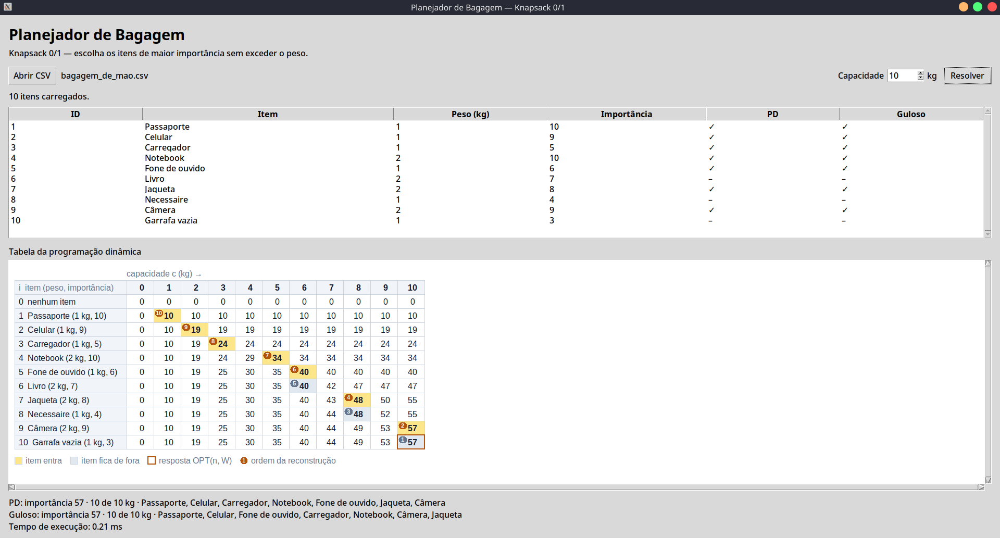
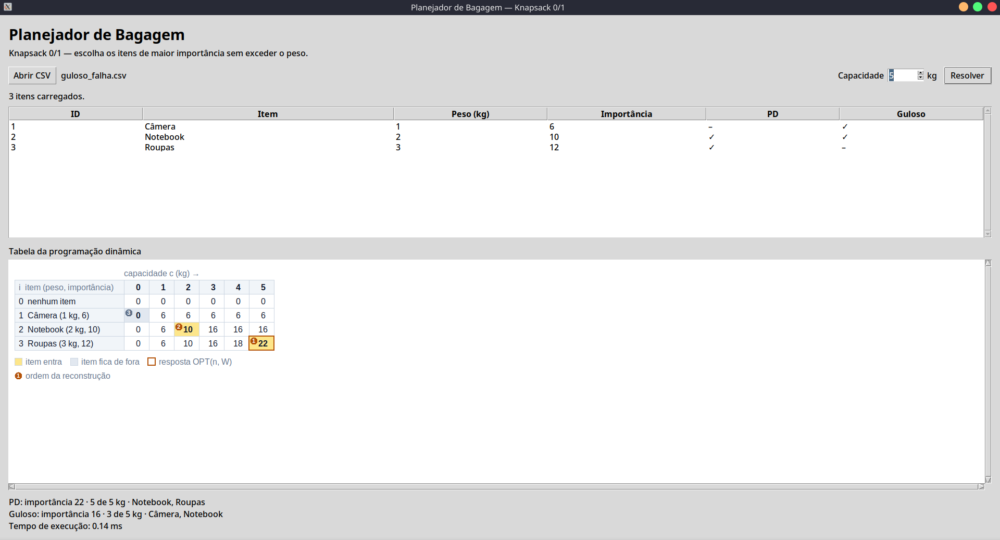
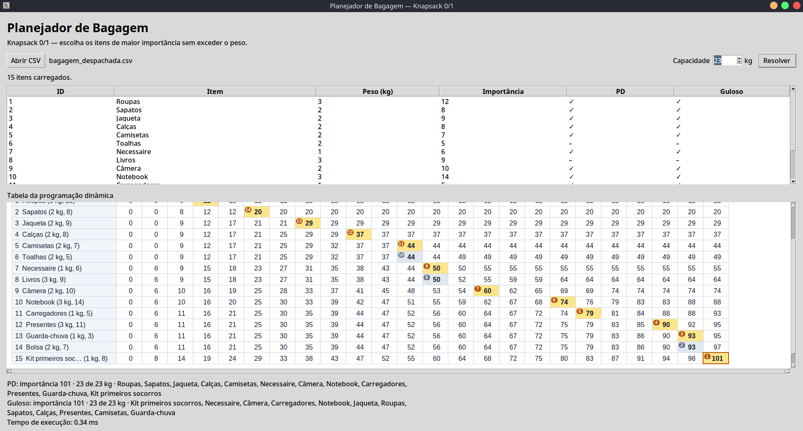

# Planejador de Bagagem com Knapsack 0/1

## Alunos

| Matrícula | Aluno |
| -- | -- |
| 211041105 | Bruna de Lima Santos |
| 212005453 | Pedro Luciano de Azevedo |

## Sobre

Trabalho 4 da disciplina de Projeto de Algoritmos do 2º semestre de 2026. O sistema ajuda a planejar uma bagagem escolhendo os itens de maior importância sem ultrapassar o limite de peso.

### Problema

Cada item possui um peso e um valor de importância. O item é levado inteiro ou fica de fora, e cada item pode ser escolhido no máximo uma vez. O objetivo é encontrar a combinação de itens com a maior importância total que caiba na capacidade da bagagem.

Uma estratégia ambiciosa que prioriza os itens com maior importância por kg pode não encontrar a melhor combinação. Por isso, o projeto resolve o problema Knapsack 0/1 com programação dinâmica.

### Solução

A interface permite abrir um arquivo CSV com os itens e informar a capacidade da bagagem, em valores inteiros de 1 a 50 kg.

Ao resolver o problema, o sistema apresenta:

- Os itens escolhidos pela programação dinâmica e pela estratégia ambiciosa;
- O peso e a importância total de cada solução;
- O tempo de execução;
- A tabela da programação dinâmica, com o caminho da reconstrução destacado.

O exemplo `exemplos/guloso_falha.csv`, com capacidade de 5 kg, mostra uma limitação da estratégia ambiciosa. A programação dinâmica escolhe Notebook e Roupas, com importância 22 e peso 5 kg. A estratégia ambiciosa escolhe Câmera e Notebook, com importância 16 e 2 kg livres.

### Algoritmo

Seja `OPT(i, c)` a maior importância que pode ser obtida usando os primeiros `i` itens e uma capacidade `c`. A tabela possui `n + 1` linhas e `W + 1` colunas, em que `n` é a quantidade de itens e `W` é a capacidade.

- Caso base: `OPT(0, c) = 0`;
- Se o item `i` não cabe: `OPT(i, c) = OPT(i - 1, c)`;
- Caso contrário: `OPT(i, c) = max(OPT(i - 1, c), valor_i + OPT(i - 1, c - peso_i))`.

A tabela é preenchida linha por linha. Para reconstruir a seleção, o algoritmo começa em `OPT(n, W)` e compara cada célula com a célula acima. Se o valor mudou, o item correspondente foi selecionado e seu peso é subtraído da capacidade restante. Em caso de empate, o item fica de fora.

### Formato de entrada

A entrada é fornecida em um arquivo CSV UTF-8 com o cabeçalho `id,nome,peso,valor` e uma linha por item:

```csv
id,nome,peso,valor
1,Câmera,1,6
2,Notebook,2,10
3,Roupas,3,12
```

O `id` deve ser inteiro e único, o nome não pode estar vazio, e peso e valor devem ser inteiros maiores ou iguais a 1. Linhas com quantidade incorreta de colunas, valores inválidos ou CSV malformado são reportadas com mensagens de erro.

O repositório inclui três exemplos:

| Arquivo | Quantidade de itens | Capacidade usada | Resultado da programação dinâmica |
| -- | --: | --: | -- |
| [`bagagem_de_mao.csv`](./exemplos/bagagem_de_mao.csv) | 10 | 10 kg | Importância 57, peso 10 kg |
| [`guloso_falha.csv`](./exemplos/guloso_falha.csv) | 3 | 5 kg | Importância 22, peso 5 kg |
| [`bagagem_despachada.csv`](./exemplos/bagagem_despachada.csv) | 15 | 23 kg | Importância 101, peso 23 kg |

### Complexidade

O preenchimento da tabela de programação dinâmica processa `n` itens para cada capacidade inteira de 0 a `W`. A reconstrução percorre no máximo uma linha por item.

| Operação | Complexidade |
| -- | -- |
| Ler o CSV | `O(n)` |
| Preencher a tabela da programação dinâmica | `O(nW)` |
| Reconstruir a solução | `O(n)` |
| Desenhar a tabela | `O(nW)` |
| Executar a estratégia ambiciosa | `O(n log n)` |
| **Complexidade da programação dinâmica** | **`O(nW)`** |

O espaço da tabela é `O(nW)`. A complexidade é pseudo-polinomial porque depende do valor numérico da capacidade `W`, e não apenas do tamanho em bits da entrada. O limite de 50 kg da interface mantém a tabela em um tamanho prático.

## Screenshots

### Cenário 1: Bagagem de mão

- **Arquivo:** `exemplos/bagagem_de_mao.csv`;
- **Capacidade:** 10 kg;
- **Resultado da programação dinâmica:** importância 57, peso 10 kg.



### Cenário 2: Falha da estratégia ambiciosa

- **Arquivo:** `exemplos/guloso_falha.csv`;
- **Capacidade:** 5 kg;
- **Programação dinâmica:** importância 22, com Notebook e Roupas;
- **Ambicioso:** importância 16, com Câmera e Notebook.



### Cenário 3: Bagagem despachada

- **Arquivo:** `exemplos/bagagem_despachada.csv`;
- **Capacidade:** 23 kg;
- **Resultado da programação dinâmica:** importância 101, peso 23 kg.



## Vídeo

Link para a apresentação: pendente.

## Instalação

### Pré-requisitos

Antes de começar, certifique-se de ter:

- Python 3.10 ou superior;
- Git;
- Tkinter (em algumas distribuições Linux, precisa ser instalado como pacote de sistema).

### 1) Clone o repositório

```bash
git clone https://github.com/projeto-de-algoritmos-2026/G29_Programacao_dinamica_PA-26.2.git
cd G29_Programacao_dinamica_PA-26.2
```

### 2) Instale as dependências do sistema

Em distribuições baseadas em Ubuntu ou Debian:

```bash
sudo apt update
sudo apt install python3 python3-venv python3-tk
```

### 3) Crie e ative o ambiente virtual

```bash
python3 -m venv .venv
source .venv/bin/activate
```

### 4) Instale as dependências do projeto

```bash
python -m pip install -r requirements.txt
```

## Execução

Na raiz do projeto, ative o ambiente virtual:

```bash
source .venv/bin/activate
```

Em seguida, execute:

```bash
python -m src.main
```

Na janela, abra um CSV, informe a capacidade inteira da bagagem e selecione **Resolver**.

### Testes

```bash
python -m pytest
```
